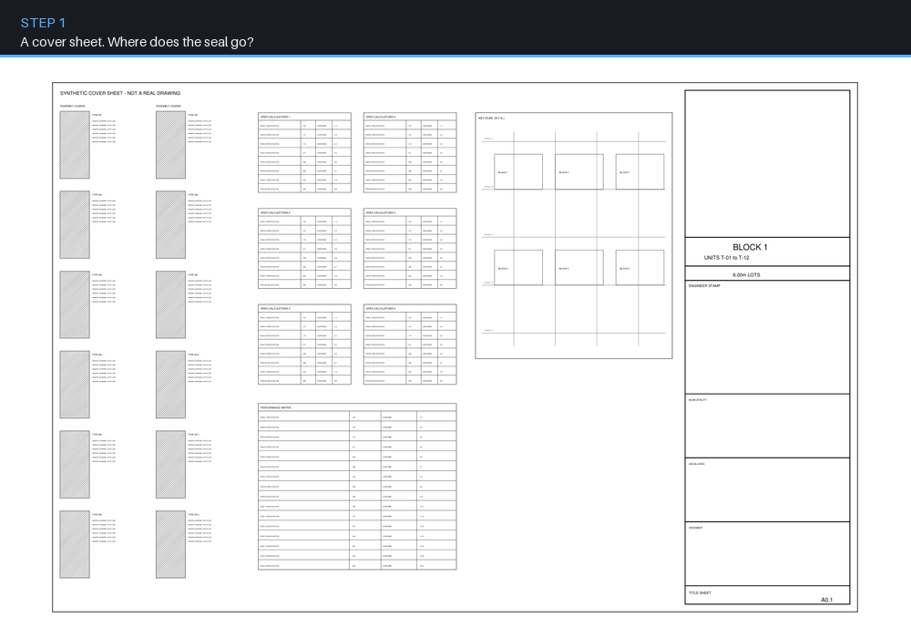

# Computer Vision Layout Stamping System



Before a set of technical drawings can be issued, a certifying mark has to be
placed on every page — in a spot that does not cover anything important, on
sheets that may run to dozens of pages. This tool finds that spot on each page
automatically, then writes the mark and its date into a new copy of the file
while leaving every bit of the original content untouched.

*Everything in the animation is synthetic — both the sheets and the seal are
generated by a script in this repository, and the placements come from running
the real pipeline over them.*

---

## The interesting problem

### Scoring every candidate position in constant time

The naive search is: for each candidate centre, sum the ink under a seal-sized
window. That is O(d²) per candidate, and there are tens of thousands of
candidates on a large sheet — the cost scales with the *square of the seal size*
for no good reason.

The page is rasterised once to a binary ink mask and reduced to a **summed-area
table** (integral image), after which the ink under any axis-aligned rectangle
is four array lookups:

```python
ink = I[y1, x1] - I[y0, x1] - I[y1, x0] + I[y0, x0]
```

Every candidate is then O(1) regardless of seal diameter, and the whole
candidate grid is evaluated as one vectorised NumPy expression. The table is
`uint32` rather than `int64` — the running count cannot exceed `H·W`, so half
the memory is wasted otherwise, and the summed-area identity stays correct under
unsigned arithmetic because every window sum is non-negative by construction.

### The tie-break nobody expects to need

On a sparse sheet, *most* candidate positions contain no ink at all. The minimum
is not unique — it is a large plateau — so taking the first minimum puts the
seal wherever the scan happened to start, which is hard against a margin.

The tie is broken by **clearance**: among the candidates tied for least ink,
pick the one at the centre of the largest ink-free square that still fits on the
page. Because those squares are bounded by the page edges, the result is pulled
toward the middle of open space rather than into a corner. It reuses the same
summed-area table, so each clearance test is also O(1) — no distance transform,
no new dependency.

It only ever re-orders candidates that are *already* tied on ink. It never
trades ink coverage for clearance.

### Search on a square, report on the circle

The search scores a **square** footprint because that is what the summed-area
table can answer in constant time. The coverage figure reported to the operator
uses the **exact circle**. The square is a strict over-estimate of the disk, so
the search errs toward more clearance than it promises — and the number shown to
a human is the honest one. There is a test asserting exactly this: ink parked in
the square's corners must score zero disk coverage.

### A reserved corner, and the one thing allowed to override it

Municipal reviewers stamp the top-right corner of a sheet, so that region must
never be used automatically — and it is often the emptiest area on the page,
which means a pure least-ink search will choose it every time. It is excluded by
default as a fraction of page width and height, plus padding.

The exception matters as much as the rule: a cell explicitly labelled for the
engineer's mark is **exempt**, because a designated box is an instruction, and
on real title blocks that box legitimately overlaps the reserved corner. The
`cover` sample reproduces exactly this geometry.

The exclusion is enforced in three places — at search time, via a logic-version
value folded into every cache key, and by an uncached sanitising pass that runs
before every preview and download. That is more than it sounds like it needs,
and the reason is that a stale cached placement survives a plain rerun; belt and
braces on the one failure that would put a mark somewhere it legally must not
be.

### The output is not flattened

The mark is inserted as an overlay image at native resolution and the date as
real selectable text. Existing vector and raster content is never rasterised or
recompressed, and the file is saved with object-stream de-duplication and
lossless deflate only. These are documents that get issued and archived, so
"looks the same" is not the standard — byte-level preservation of the original
content is.

---

## Try it in two commands

```bash
pip install -r requirements.txt
python examples/make_sample_sheet.py
```

That generates a synthetic seal and two synthetic sheets, runs the real
placement pipeline over both, and writes stamped copies. Observed output:

```
--- cover ------------------------------------------------
  page 1: source=engineer_box centre=( 2273.5,  846.5) pt  dia= 230.4 pt  ink= 0.00%
--- notes ------------------------------------------------
  page 1: source=whitespace   centre=( 1590.5,  786.5) pt  dia= 136.8 pt  ink= 0.21%
```

Two different code paths, deliberately:

- **`cover`** is a cover sheet with a full-height title-block column. It has a
  large blank municipal box at the top of that column and a labelled engineer's
  cell below it that overlaps the reserved corner. The mark goes in the labelled
  cell (`source=engineer_box`), sized to fill it, and never in the blank box
  above — which is the bigger, emptier target.
- **`notes`** is a dense details sheet with no labelled cell and almost no free
  space. The whitespace search has to work for it, and reports the ink it could
  not avoid (`0.21%`) rather than pretending it found a clean spot.

Generate one at a time with `--variant cover` or `--variant notes`.

For the browser UI:

```bash
streamlit run app.py
```

Automatic placement is a starting point, not a verdict. The UI exposes
click-to-place, positional sliders, seal diameter, apply-to-all-pages,
per-page removal, the reserved-corner fractions and padding, the caption text,
the date's font size and colour, and a full recompute that discards every cached
placement.

## Tests

```bash
pip install pytest
python -m pytest tests/ -q     # 18 tests
```

The integral image is verified against brute-force cumulative sums at *every*
cell, and the window sums against brute force over a random mask. The rest cover
the behaviour that is easy to get subtly wrong: keep-out rectangles are
respected, a keep-out covering the whole page returns nothing rather than a bad
placement, the clearance tie-break provably moves the mark off the corner that
plain `argmin` would choose, and disk coverage is stricter than the square
estimate. `PageOccupancy` is a plain dataclass, so all of this runs on synthetic
NumPy masks with no PDF involved — the suite finishes in under a second.

## Scope and limitations

- **Designed against E-size landscape sheets** (36 × 24 in) with real text.
  Other sizes work because everything is proportional, but the reserved-corner
  fractions were chosen for that shape and may need adjusting.
- **Cell detection needs real text.** The labelled cell is found by searching
  for its literal label, so a title block where the label is part of a
  rasterised image will not be detected — the tool falls back to the whitespace
  search.
- **Cell bounds are inferred from the title block's ruling lines.** An unusual
  title-block structure can produce a wrong box; the operator can always click
  to place instead, and there is a safe fallback size.
- **The caption can overhang a tight cell.** It sits below the circle and is not
  part of the collision search — only the circular mark is. On a tight cell it
  may cross the cell's bottom rule by a few points. Shorten or clear the caption,
  or reduce the diameter.
- **Rotation is handled for 0° and 270°**, which were exercised on real sheets.
  90° and 180° use the same mechanism but were not.
- **Previews are an approximation.** The on-screen preview composites onto a
  cached raster and does not use the PDF's own font. The downloaded PDF is the
  source of truth.
- Placement is per page with no cross-page consistency constraint beyond
  apply-to-all.

See [`ASSUMPTIONS.md`](ASSUMPTIONS.md) for the full list of design assumptions,
including the ones worth confirming against your own drawing standards.

## Layout

```
stamper/          the library: occupancy, placement, engineer_box, pdf_writer
app.py            browser UI (Streamlit)
desktop_app.py    packaged desktop entry point
packaging/        PyInstaller spec and Windows installer
examples/         synthetic sheet + seal generators
tests/            pytest suite over the search
```

## Provenance

Developed at **D.L. Engineering Inc.** and published with the firm's written
permission. Client drawings, firm documents, internal identifiers and
proprietary data are excluded. **No real professional seal appears in this
repository** — seals are legal signatures, `.gitignore` excludes the `stamps/`
directory entirely, and the seal in the demo is drawn from scratch by the
example script.

Licensed under the MIT License.
